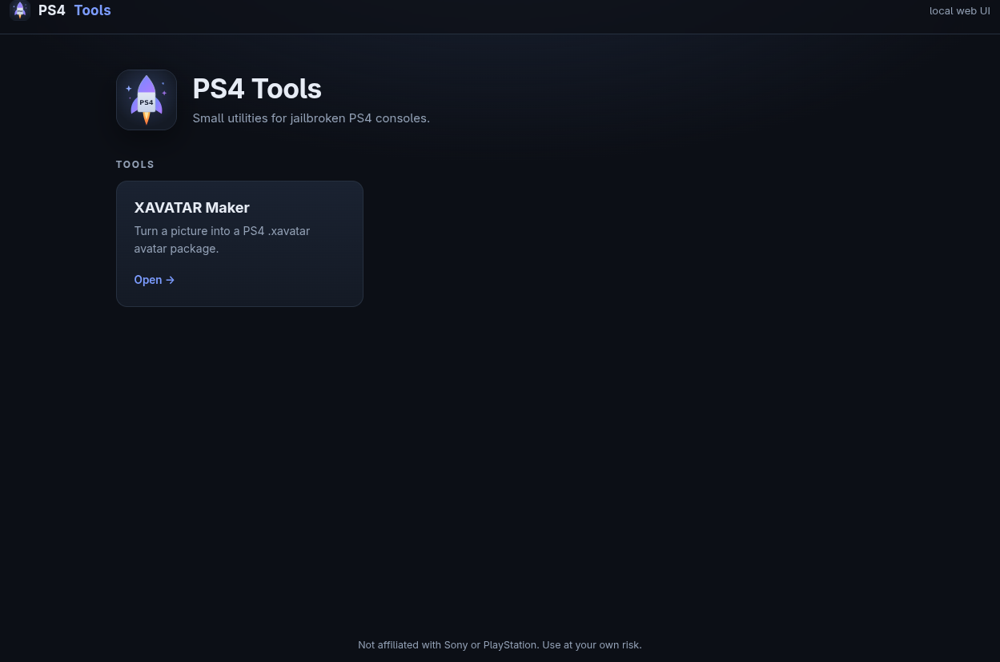

<p align="center">
  
</p>

# PS4 Tools

Small utilities for jailbroken PS4 consoles, served as a local web app.



## Install

```bash
./install.sh
```

The script detects your package manager (`pacman`, `apt`, `dnf`, `zypper`,
`apk`), shows the exact command and asks before installing **Pillow** and
**ImageMagick**. Re-running it is safe: anything already present is skipped.

- `./install.sh --yes` — no confirmation prompt
- If the system Pillow package is unavailable, it creates a local `.venv`
  instead, so no root access is needed for Pillow
- Everything runs locally; nothing is downloaded at runtime except the
  packages themselves

## Quick start

```bash
./ps4-tools.sh
```

It prints a URL and opens it in your browser:

```
  PS4 Tools
  → http://127.0.0.1:8765/
  Ctrl+C to stop
```

If dependencies are missing on the first launch, it offers to run `./install.sh`
for you. The server listens on `127.0.0.1` only, and images you drop on the page
are processed locally — they are never uploaded anywhere.

### Options

| Flag | Default | Meaning |
| --- | --- | --- |
| `--port N` | `8765` | Port to use (the next free one is picked automatically) |
| `--host H` | `127.0.0.1` | Bind address; `0.0.0.0` exposes it to your LAN |
| `--no-browser` | off | Print the URL without opening a browser |

## Tools

### XAVATAR Maker

Turns a picture into a PS4 `.xavatar` package, made for
**offline-activated accounts**.

- Drag and drop, browse, or paste an image (PNG, JPG, WebP, BMP)
- Live preview rendered by the same pipeline that builds the package
- **Center-crop** (default) or stretch to a square
- **Circle mask** — transparent corners, kept by DXT5 alpha
- **Offline profile set** (default) — adds `picture*.dds` and `online.json`
- Downloads `<name>.xavatar` straight to your Downloads folder

The same conversion is available from the command line:

```bash
python3 -m tools.xavatar.cli photo.png                      # full offline package
python3 -m tools.xavatar.cli photo.png Out.xavatar          # custom name
python3 -m tools.xavatar.cli photo.png --stretch --circle   # stretch + circle mask
python3 -m tools.xavatar.cli photo.png --no-offline         # avatar files only (online PSN account)
```

#### Install on the PS4

1. Copy the `.xavatar` to a USB drive.
2. Open **PS4-Xplorer** and press **✕** on the file.

Or copy it to `/data/AVATARS/` and apply it from **Avatar Changer**
(`PS4_LAPY20015`).

#### Package format

A `.xavatar` is a flat ZIP containing:

```
avatar.png   avatar64.dds  avatar128.dds  avatar260.dds  avatar440.dds
```

plus, with the offline profile set:

```
picture.png  picture64.dds picture128.dds picture260.dds picture440.dds
online.json
```

DDS files are DXT5 without mipmaps. Every PNG and DDS is validated (size,
header, dimensions, fourCC, texture size, ZIP entry names) before the package
is written, so a broken file is never produced.

## Credits

- `.xavatar` format and the original **PS4-Xplorer Avatar Maker** by
  [Lapy](https://x.com/Lapy05575948).
- The `online.json` metadata matches Lapy's Avatar Maker 1.7 output for
  offline-activated accounts.

## Disclaimer

Not affiliated with Sony or PlayStation. Use at your own risk and only with
images you have the right to use.

## License

MIT — see [LICENSE](LICENSE).
